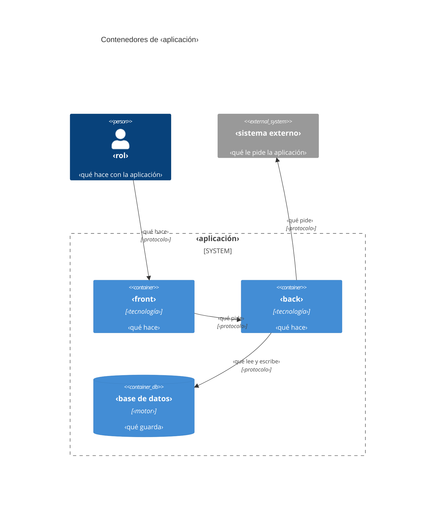

# Diseñar o documentar la arquitectura de una aplicación

Contesta **«¿cómo está armada y por qué?»**: qué partes tiene la aplicación, con qué habla, dónde corre, qué
atributos de calidad la ordenan y qué decisiones la dejaron así. Produce un **borrador**; al Cerebro entra lo que la
persona valida, por `cerebro-curator`. **Nada se inventa**: un elemento sin fuente va marcado `⚠ supuesto`, con su
pregunta (regla 3 de [[AGENTS]]).

Las ideas vienen del modelo C4, de MADR y de los ADR (bibliografía:
`cerebro-digital/configuracion-ia/referencias-externas/referencias-arquitectura-e-infraestructura.md`); el texto y
las reglas son propios.

## Antes de empezar

1. **Lo que ya está decidido**: `cerebro-digital/modulo-ejemplo/arquitectura/decisiones.md` (`DEC-001` dónde vive
   el código, `DEC-002` módulos de dominio con capas, `DEC-003` el stack, `DEC-007` la plataforma y la
   infraestructura). Una decisión confirmada no se rediscute acá: se cita.
2. **Lo que el Cerebro ya sabe**: el contexto del proyecto, las fichas funcionales (sus integraciones con otros
   sistemas), [[esqueleto-proyectos]] (los repositorios), [[ambientes]] e [[infraestructura]].
3. **Si la aplicación ya existe**, se arranca de abajo hacia arriba, de los hechos: lo que dejó [[absorber-aplicacion]]
   o `python bin/radiografiar-codigo.py <ruta-de-la-app> --mermaid` (módulos, cruces de capa, integraciones, cada
   hecho con `archivo:línea`). Los componentes salen del código; los contenedores, de los componentes; el contexto,
   de las integraciones.

## La vista C4: tres diagramas, no cuatro

| Diagrama | Qué muestra | Cuándo |
|---|---|---|
| **Contexto** | La aplicación como una caja, las personas (por rol) que la usan y los sistemas con los que habla | Siempre |
| **Contenedores** | Lo que se despliega por separado (front, back, base, cola, tarea programada) y cómo se hablan | Siempre |
| **Despliegue** | Dónde corre cada contenedor en cada ambiente: plataforma, red, nodos | Cuando hay infraestructura; vive en [[infraestructura]] |
| Componentes | El interior de **un** contenedor | Sólo si ese contenedor lo justifica; en el back, los módulos de `DEC-002` ya lo dicen |
| Código | Clases | Nunca a mano: sale de la herramienta del lenguaje |

**Mermaid**, porque el Cerebro ya lo usa, se versiona como texto y no pide nada instalado: `C4Context`,
`C4Container` y `C4Deployment`. Su soporte de C4 tiene huecos declarados: **no tiene leyenda, etiquetas ni
diseño manual** (`Lay_*`). Por eso **cada diagrama va con su tabla de elementos**, que hace de leyenda y de
fuente. Si un diagrama C4 no se lee bien, un `flowchart` con la misma tabla vale igual.

Molde (los nombres entre `‹ ›` se reemplazan; los marcadores de persona, por rol):



| Elemento | Tipo | Tecnología | Qué hace | Fuente | Estado |
|---|---|---|---|---|---|
| `back` | contenedor | ‹tecnología› | ‹qué hace› | `DEC-003` · `<ficha>` · `<archivo:línea>` | confirmado · `⚠ supuesto` |

### El chequeo de cada diagrama (lo revisa el verificador, uno por uno)

- Tiene **título** que dice qué diagrama es y de qué alcance.
- **Cada elemento** tiene nombre, tipo, tecnología (salvo personas) y una descripción de qué hace.
- **Cada relación** tiene etiqueta (qué pasa por ahí) y, entre contenedores, el protocolo. Una flecha sin etiqueta
  es una pregunta, no un dato.
- **Cada fila de la tabla** tiene su fuente (una `DEC`, una ficha, un `archivo:línea`) o dice `⚠ supuesto` con la
  pregunta que va a `cerebro-digital/modulo-ejemplo/pendientes.md`.
- Sin siglas sin explicar, sin nombres de personas (roles) y sin direcciones reales (alias).

## Los atributos de calidad

Son lo que ordena la arquitectura: sin ellos, cualquier opción «está bien». Cada uno se escribe como un **escenario
medible**: qué pasa, en qué condición, y cuánto es aceptable.

| Atributo | Pregunta que lo vuelve medible | Dónde se usa |
|---|---|---|
| **Carga y rendimiento** | ¿Cuántos a la vez, qué tiempo de respuesta es aceptable? | [[esqueleto-proyectos]] §«Carga esperada» y la dimensión 4 de `cerebro-digital/configuracion-ia/skills/desarrollo/references/metodo/code-review.md` |
| **Disponibilidad** | ¿Cuánto tiempo caído se tolera por mes? ¿En qué horario importa? | Cuántas réplicas y zonas en [[infraestructura]] |
| **Recuperación** | ¿Cuántos datos se pueden perder (minutos) y cuánto tarda en volver? | Respaldos y `prevent_destroy` |
| **Seguridad y datos sensibles** | ¿Qué datos de personas hay y quién los ve? | `cerebro-digital/configuracion-ia/skills/desarrollo/references/metodo/seguridad-y-datos-sensibles.md` |
| **Observabilidad** | ¿Cómo se sabe que anda mal antes que el usuario? | `cerebro-digital/configuracion-ia/skills/desarrollo/references/metodo/observabilidad.md` |
| **Costo** | ¿Cuánto por mes es aceptable, por ambiente? | `DEC-007` |
| **Mantenibilidad** | ¿Quién lo mantiene y con qué conocimiento? | La elección del stack (`DEC-003`) |

Un número que nadie dio va `⚠` con su pregunta, nunca estimado por la IA: contra él se van a juzgar las decisiones.

## Conducir una decisión técnica hasta su `DEC-nnn`

**¿Merece una DEC?** Sí, si cumple al menos una: cuesta caro volver atrás, afecta a más de un módulo o equipo, elige
entre opciones reales, o mueve un atributo de calidad. Un detalle que se cambia en un Merge Request no es una DEC.

El borrador (`borrador/arquitectura/<fecha>-<tema>.md`) tiene estas partes, en este orden:

1. **Contexto y problema**, en dos o tres oraciones: qué hay que decidir y por qué ahora.
2. **Impulsores**: los atributos de calidad y las restricciones en juego (de la organización, de `DEC-001` a
   `DEC-007`, de la licencia, del presupuesto).
3. **Opciones consideradas**: al menos dos reales, y la de no cambiar nada si existe. Por cada una, **pros y
   contras con su fuente** (documentación oficial, una medición, un `archivo:línea`), no opiniones.
4. **Recomendación, marcada `⚠`**: cuál y por qué, contra los impulsores. Es una propuesta: la IA no decide por
   el equipo.
5. **Consecuencias**: lo que se gana, lo que se paga y lo que queda afuera.
6. **Cómo se confirma**: qué evidencia va a decir que fue la correcta (una prueba de carga, una regla del build
   que verifica los límites, el costo del primer mes) y cuándo se mira.
7. **Qué reemplaza**: si cambia una decisión anterior, cuál; la vieja queda como superada, con el enlace.

La pregunta, en criollo: *«Para guardar los archivos que suben los usuarios veo dos caminos: el almacenamiento de
objetos de la nube que elijamos o una carpeta en el servidor. Recomiendo el primero porque sobrevive a que se caiga
el servidor y no hay que respaldarlo aparte; cuesta un poco por mes. ¿Lo escribo como decisión?»*

Con el «sí», la escribe **`cerebro-curator`** en `cerebro-digital/modulo-ejemplo/arquitectura/decisiones.md`, con el molde de ese archivo (estado, qué se
decidió, por qué, qué queda afuera, de dónde salió, pie `_Últ. modif._`); lo que quedó `⚠` va con su pregunta a
`cerebro-digital/modulo-ejemplo/pendientes.md`. Lo que la decisión fija sobre la infraestructura cambia además [[infraestructura]].

## Presentar

Si hace falta mostrarlo como página (una reunión, un entregable), [[archify]] lo dibuja desde el Mermaid y la tabla,
con salida en `borrador/diagramas/`. La fuente sigue siendo el Mermaid del Cerebro: lo que cambie, cambia ahí.

## La verificación (otro agente, sólo lectura, contexto limpio)

`nucleo-verificador` lee el borrador sin haber visto cómo se hizo y contesta:

- ¿Cada diagrama pasa el chequeo de arriba, elemento por elemento y relación por relación?
- ¿Cada fuente citada existe y dice eso? Una `DEC` que no está, una ficha que no lo dice o un `archivo:línea` que
  no coincide es **HALLAZGO**.
- ¿Cada decisión tiene al menos dos opciones con pros y contras con fuente, recomendación en `⚠` y cómo se
  confirma?
- ¿Algún atributo de calidad tiene un número que nadie dio?

```
VEREDICTO-INICIO
vista C4 (<diagrama>)      : OK | HALLAZGO | SIN DATOS (<motivo>)   -- criterio: <elementos, relaciones, fuentes>
atributos de calidad       : OK | HALLAZGO | SIN DATOS (pendiente declarado: <cuáles en ⚠>)
decisión (<tema>)          : OK | HALLAZGO | SIN DATOS (<motivo>)   -- criterio: <opciones, fuentes, cómo se confirma>
BLOQUEANTES: <n>   SIN DATOS (no se pudo mirar): <n>   SIN DATOS (pendiente declarado): <n>
Verificado por: <herramienta> · <modelo> · sólo lectura, contexto limpio
VEREDICTO-FIN
```

## Qué queda dónde

| Qué | Dónde |
|---|---|
| Los diagramas y las decisiones en curso | `borrador/arquitectura/` (nunca se versiona) |
| Una decisión validada | [[decisiones]] del módulo, por `cerebro-curator` |
| La vista de despliegue validada | [[infraestructura]] §«Vista de despliegue», por `cerebro-curator` |
| La vista de contexto y la de contenedores validadas | El pilar `arquitectura/` del módulo, por `cerebro-curator` (⚠ todavía no hay una ficha fija para ellas: se pregunta dónde) |
| Lo que nadie supo contestar | `cerebro-digital/modulo-ejemplo/pendientes.md`, con su pregunta |
