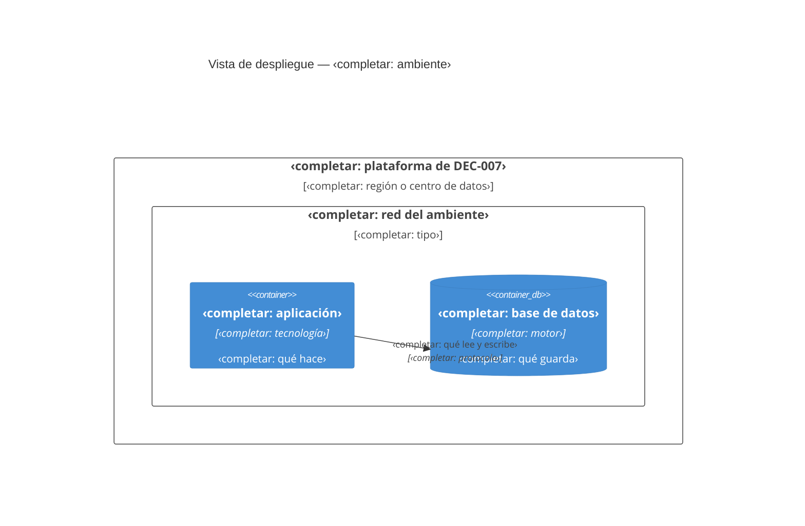

# Infraestructura — modulo-ejemplo

> Lo que la infraestructura **es**, en palabras: el código que la crea vive en su propio repositorio (`DEC-001`) y
> **cita** esta ficha, no la copia. Nace **vacía, con una fila de molde** entre `<...>`: mientras una tabla no tenga
> filas cargadas, lo que dependa de ella es `SIN DATOS`. La completa una persona, o `cerebro-curator` con su «sí»;
> cada cambio, con su firma en [[log]]. La plataforma, la herramienta y el gestor de secretos los fija
> [[decisiones#DEC-007]]; lo que esté `⚠` ahí, acá también. Cómo se diseña, se escribe y se audita:
> [[arquitectura-e-infraestructura]].

## Recursos por ambiente

La lista de ambientes, con quién aprueba cada uno, está en [[ambientes]]: acá se usan sus nombres exactos, y un
ambiente que no figure ahí no tiene recursos.

| Ambiente | Recurso (rol) | Tipo | Guarda datos | Protegido contra borrado | Lo declara (módulo o archivo) | Estado |
|---|---|---|---|---|---|---|
| `<ambiente de ambientes.md>` | `<la base principal>` | `<tipo de recurso>` | sí | sí | `<modules/datos>` | `⚠ a confirmar` |

- **Guarda datos**: `sí` si perderlo pierde datos (una base, un almacenamiento, un gestor de secretos, una cola).
  Todo lo que guarda datos va protegido contra borrado en el código.
- Los **servidores, clusters y URLs** que la IA puede tocar no van acá: van en [[inventario]], con su nivel.

## Convención de nombres y etiquetas

**Patrón de nombre:** `<completar: por ejemplo aplicacion-ambiente-rol-numero>`. Sin datos de personas ni nada que
identifique a la organización más allá de lo que fije el equipo.

| Etiqueta | Qué va | Ejemplo |
|---|---|---|
| `ambiente` | El nombre exacto de [[ambientes]] | `<ambiente>` |
| `aplicacion` | La aplicación a la que sirve | `<aplicacion>` |
| `dueno` | El **rol** que responde por el recurso | `<rol>` |
| `centro-de-costo` | Dónde se imputa el costo | `<completar>` |
| `gestionado-por` | Que lo crea la infraestructura como código (no se toca a mano) | `iac` |

## Dónde vive el estado

| Ambiente | Backend (tipo) | Dónde (nombre, no la clave de acceso) | Bloqueo | Cifrado en reposo | Historial de versiones | Quién accede (rol) |
|---|---|---|---|---|---|---|
| `<ambiente>` | `<tipo de backend de DEC-007>` | `<contenedor y clave del estado>` | `<sí>` | `<sí>` | `<sí>` | `<rol del pipeline>` |

Un estado **por ambiente**; dos ambientes nunca comparten el mismo (lo cuenta `bin/auditar-iac.py`). El estado es
texto plano y puede tener secretos: nunca se versiona, y lo lee sólo quien lo necesita.

## Cómo entran los secretos

| Secreto (nombre lógico) | Dónde vive | Cómo llega a la aplicación | Quién lo rota (rol) | Cada cuánto |
|---|---|---|---|---|
| `<clave de la base>` | `<gestor de secretos de DEC-007>` | `<variable de entorno o archivo montado>` | `<rol>` | `<completar>` |

- **Nunca el valor**: ni acá, ni en el código, ni en una variable versionada, ni en una imagen.
- **El pipeline entra sin secretos guardados** (identidad federada, una por ambiente): ⚠ a confirmar en `DEC-007`.
  Configurarla y rotar un secreto lo hace una persona.

## Qué datos hay en cada ambiente

| Ambiente | Qué datos tiene | De dónde salen | Datos de personas |
|---|---|---|---|
| `<ambiente>` | `<completar>` | `<sintéticos, anonimizados o reales>` | `<no>` |

**Fuera de producción, ningún dato real de una persona** (PHI): datos sintéticos o con marcadores (`<persona>`,
`<documento>`, `<identificador>`).

## Vista de despliegue

Dónde corre cada contenedor de la arquitectura en cada ambiente. Lo que dice `‹completar›` se reemplaza; cada
elemento va con su fila en la tabla de abajo (Mermaid no tiene leyenda: la tabla la reemplaza).

| Elemento | Tipo | Tecnología | Fuente | Estado |
|---|---|---|---|---|
| `<app>` | `<contenedor>` | `<completar>` | `<DEC, ficha o archivo:línea>` | `⚠ supuesto` |

## Lo que esta ficha no guarda

- **La lista de ambientes y quién aprueba**: [[ambientes]].
- **Los servidores, clusters y URLs autorizados para la IA**: [[inventario]].
- **Los valores de los secretos y las credenciales**: en el gestor de secretos y en la plataforma; los toca sólo una
  persona.
- **El código**: en el repositorio de infraestructura, por [[desarrollo]].

_Últ. modif.: 2026-11-14 — @equipo — plantilla heredada del template (M-047)_
