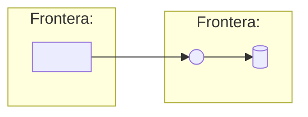

# Modelo de amenazas — `<flujo>` — modulo-ejemplo

> **Cómo se usa este molde.** Se copia a `borrador/amenazas/<flujo>.md` y se completa con la skill [[seguridad]]
> (su referencia `modelar-amenazas.md`); lo revisa otro agente con contexto limpio y lo valida una persona. Recién ahí
> `cerebro-curator` lo persiste en `seguridad/amenazas/<flujo>.md`, con su firma en [[log]].
>
> - **Un flujo por modelo**, nunca la aplicación entera.
> - **Nada sin fuente**: cada elemento y cada amenaza citan la ficha o `archivo:línea`; lo que no, va `⚠ supuesto`.
> - **«Aceptar» un riesgo lo decide una persona**; la IA sólo lo propone.
> - Sin direcciones, sin nombres reales de servidores, sin secretos ni datos de personas: los activos, por su alias
>   de [[inventario]]; las personas, por rol.

**Flujo:** `<nombre>` · **Ficha:** `funcional/<flujo>.md` · **Fecha:** `<AAAA-MM-DD>` · **Modeló:** `<rol>` ·
**Revisó (contexto limpio):** `<rol>` · **Validó:** `<rol>`

## Insumos

| Insumo | Ruta | Fecha o versión |
|---|---|---|
| Ficha funcional del flujo (pasos, reglas, datos sensibles) | `funcional/<flujo>.md` | `<...>` |
| Radiografía del código (endpoints, integraciones, permisos, con `archivo:línea`) | `<informe de bin/radiografiar-codigo.py>` | `<...>` |
| Contrato | `<ruta del openapi.yaml>` | `<...>` |
| Stack y despliegue | `DEC-003` en [[decisiones]] | `<...>` |
| Activos, ambiente y exposición a internet | [[inventario]] | `<...>` |

## 1. ¿En qué trabajamos?

| Elemento | Tipo (actor · proceso · almacén · flujo · frontera) | Fuente (ficha o `archivo:línea`) o `⚠ supuesto` | ¿Lleva dato sensible? |
|---|---|---|---|
| `<...>` | `<...>` | `<...>` | `<sí · no>` |

## 2. ¿Qué puede salir mal?

STRIDE por elemento y por cada flujo que cruza una frontera. Si un componente usa un modelo de lenguaje o un agente,
también el Top 10 de OWASP para LLM (2025) y el agéntico (2026). Cada flujo con dato sensible tiene revisadas, como
mínimo, la manipulación (T) y la divulgación (I). Cada frontera tiene al menos una amenaza revisada.

| ID | Elemento o flujo | Categoría | Quién la ejecuta | Por qué frontera entra | Qué gana | Evidencia (`archivo:línea` o ficha) | Control que ya existe, con su evidencia, o «no encontrado» |
|---|---|---|---|---|---|---|---|
| A-01 | `<...>` | `<S · T · R · I · D · E · LLMnn · ASInn>` | `<...>` | `<...>` | `<...>` | `<...>` | `<...>` |

## 3. ¿Qué hacemos?

| Amenaza | Respuesta propuesta (mitigar · eliminar · transferir · aceptar) | Quién decide (rol) | Requisito que sale (y su ID de ASVS 5.0, si se conoce) | Test o Escenario que lo verificaría |
|---|---|---|---|---|
| A-01 | `<...>` | `<rol: «aceptar» nunca lo decide la IA>` | `<...>` | `<...>` |

## 4. ¿Alcanzó?

- **Supuestos** (cada `⚠ supuesto` de arriba, y qué cambia si resulta falso): `<...>`
- **Preguntas abiertas** → `[[pendientes#P-nnn]]`: `<...>`
- **Lo que este modelo no cubre, y por qué**: `<...>`

_Últ. modif.: 2026-11-14 — @equipo — plantilla heredada del template (M-050)_
